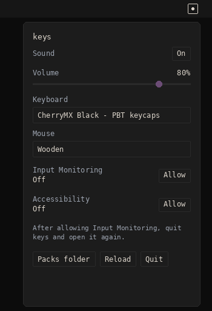

# keys

keys is a small macOS menu bar app. It plays a mechanical keyboard sound when you type, and a click when you use the mouse.



## Features

- Volume, mute, and pack switching from the menu bar
- Ten keyboard packs and four mouse packs
- Space and Enter play lower than the letter keys
- A second slice in a pack plays when the key is released
- Keystrokes are not logged or saved

## Build on macOS

keys needs macOS 13 or later.

Install the Xcode command line tools if `swift` is not already available:

```
xcode-select --install
```

Then:

```
git clone https://github.com/tobenwarrior/keys.git /Users/lucas/Documents/my_test_projects/keys
cd /Users/lucas/Documents/my_test_projects/keys
make
open keys.app
```

`make` compiles a release binary, wraps it in `keys.app`, and signs it for local use. A build made on that Mac is not quarantined by Gatekeeper.

`make test` checks pack loading and playback timing. It does not open the menu bar.

## Permissions

keys has to hear the keyboard and mouse while other apps are in front.

1. Open `keys.app`. A key icon appears in the menu bar.
2. Click it. If Input Monitoring or Accessibility says Off, click Allow.
3. In System Settings, under Privacy and Security, turn keys on for Input Monitoring and for Accessibility.
4. Quit keys and open it again. macOS applies Input Monitoring to the copy that was running when you allowed it.

Granting the permission to Terminal does not cover `keys.app`. After you run `make` again, macOS may keep the old toggles but ignore them. Remove keys from both lists, add `keys.app` again, and open the app.

If a downloaded copy of `keys.app` is blocked, or macOS says it is damaged, clear the quarantine flag and open it again:

```
xattr -dr com.apple.quarantine /Users/lucas/Documents/my_test_projects/keys/keys.app
```

You do not need that command for an app you just built with `make`.

## Sound packs

The menu lists the packs shipped with the app. To add your own, make a folder with `config.json` and a 16-bit PCM WAV file:

```json
{
  "name": "Desk board",
  "audio_file": "board.wav",
  "definitions": {
    "KeyA": { "timing": [[0, 90]] },
    "Space": { "timing": [[100, 210]] },
    "Enter": { "timing": [[220, 340]] }
  }
}
```

`timing` is milliseconds from the start of the file: start, then end. The first range plays when the key goes down. A second range, if you add one, plays when the key comes up. A key can name its own WAV with `audio_file` instead of sharing one file.

Put keyboard packs here:

```
~/Library/Application Support/keys/packs/keyboard/desk-board
```

Put mouse packs in `packs/mouse/`. A pack is treated as a mouse pack when its keys are named `MouseLeft`, `MouseRight`, and so on. Click Reload in the menu.

## Credits

Sound packs from [Mechvibes](https://github.com/hainguyents13/mechvibes), used under their license. Details are in [SOUNDS.md](SOUNDS.md).

## License

MIT. Copyright Lucas Yee. See [LICENSE](LICENSE).
